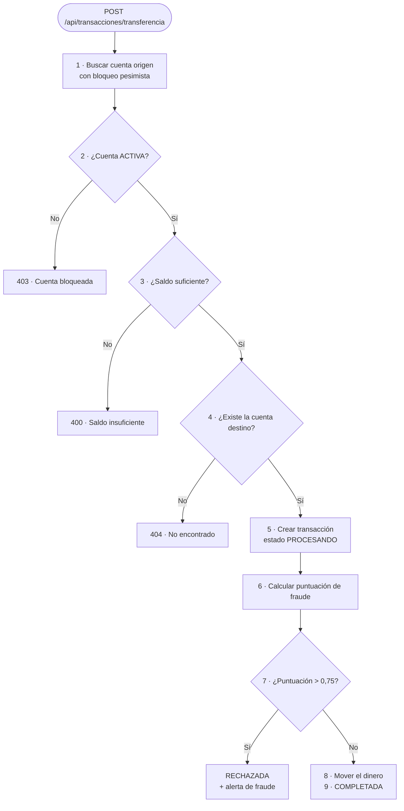

<div align="center">

# 🏦 Sistema de Procesamiento de Transacciones Financieras

**API REST en Java que procesa transferencias bancarias, calcula una puntuación de riesgo de fraude y genera alertas para su revisión.**


</div>

---

## ✨ ¿Qué hace?

Sistema backend que recibe **transferencias bancarias**, comprueba que sean válidas y evalúa cada una con un **motor de detección de fraude**. Si la operación es demasiado sospechosa, se **rechaza** y se genera una **alerta** con un nivel de riesgo que un analista puede revisar.

## 🎯 Funcionalidades

- 💸 **Transferencias** individuales y **por lotes** (en sublotes de 50), con validación de los datos de entrada.
- 🔒 **Bloqueo pesimista** de la cuenta origen para evitar condiciones de carrera al mover el dinero.
- 🚨 **Detección de fraude** mediante una puntuación ponderada (ver abajo).
- 🔍 **Consulta del estado** de cada transacción.
- 📋 **Alertas de fraude** paginadas y ordenadas por gravedad, que se pueden marcar como revisadas.
- 📣 **Notificación asíncrona** cuando se revisa una alerta de nivel crítico (pool de hilos dedicado).
- 🧾 **Resumen de cuenta**.
- 🧯 **Gestión global de errores** con respuestas JSON homogéneas.
- 🔎 **Trazabilidad**: cada operación lleva un `correlationId` en los logs (MDC).
- 🧰 **Utilidades**: detector de **ciclos** de transferencias entre cuentas (DFS sobre un grafo) y comparador para **ranking de cuentas** según alertas críticas.

## 🧭 Cómo funciona una transferencia



La API responde `202 Accepted` con un objeto de seguimiento (`id`, `estado` y `mensaje`).

### 🚨 Motor de fraude

Cada transacción recibe una puntuación entre **0 y 1** que suma el peso de cada indicador que se activa:

| Indicador | Se activa cuando… | Peso |
|---|---|---|
| 💶 Importe alto | El monto supera los 10.000 € | `0,30` |
| 🕐 Hora inusual | Se realiza entre las 00:00 y las 05:00 | `0,20` |
| ⚡ Frecuencia | La cuenta origen hace más de 3 operaciones en 5 minutos | `0,25` |
| 🆕 Cuenta nueva | La cuenta destino se creó hace menos de 7 días | `0,15` |
| 🌍 País distinto | El país habitual del destino difiere del del origen | `0,10` |

Si la puntuación **supera 0,75**, la transacción se rechaza y se crea una alerta cuyo nivel depende de la puntuación:

| Puntuación | Nivel de riesgo |
|---|---|
| `≥ 0,90` | 🔴 `CRITICO` |
| `≥ 0,75` | 🟠 `ALTO` |
| `≥ 0,50` | 🟡 `MEDIO` |
| `< 0,50` | 🟢 `BAJO` |

## 🔌 API

| Método | Ruta | Descripción | Respuesta |
|---|---|---|---|
| `POST` | `/api/transacciones/transferencia` | Procesa una transferencia | `202` + seguimiento |
| `GET` | `/api/transacciones/{id}/estado` | Consulta el estado de una transacción | `200` |
| `POST` | `/api/transacciones/lote` | Procesa un lote de transferencias | `200` + total, procesadas y rechazadas |
| `GET` | `/api/cuentas/{id}/resumen` | Resumen de una cuenta | `200` |
| `GET` | `/api/fraude/alertas` | Alertas no revisadas (paginadas, de más a menos graves) | `200` |
| `PUT` | `/api/fraude/alertas/{id}/revisar` | Marca una alerta como revisada | `200` |

### Errores

Todos los errores devuelven el mismo formato (`ErrorResponse`) con fecha, código, tipo, mensaje y ruta:

| Situación | Código |
|---|---|
| Saldo insuficiente | `400` |
| Datos de entrada no válidos | `400` |
| Cuenta bloqueada o cerrada | `403` |
| Cuenta, transacción o alerta no encontrada | `404` |
| Error inesperado | `500` |

## 🗂️ Estructura

```
src/main/java/com/banco/transacciones/
├── controller/   # Endpoints REST (Transaccion, Cuenta, Fraude)
├── service/      # Interfaces y lógica de negocio (impl/)
├── repository/   # Spring Data JPA
├── model/
│   ├── entity/   # Cliente, Cuenta, Transaccion, AlertaFraude
│   ├── enums/    # EstadoCuenta, EstadoTransaccion, NivelRiesgo, TipoCuenta, TipoTransaccion
│   └── dto/      # request/ y response/ (incluye el validador CuentasDistintas)
├── mapper/       # MapStruct: entidad ↔ DTO
├── util/         # FraudeScoreCalculator, CicloTransaccionDetector, RankingCuentasComparator
├── config/       # AsyncConfig (pool de hilos "transaccionExecutor")
└── exception/    # Excepciones de negocio y handler/GlobalExceptionHandler
```

## 🛠️ Tecnologías

| Área | Tecnología |
|---|---|
| Lenguaje | Java 21 |
| Framework | Spring Boot 3.5 (Web, Data JPA, Validation) |
| Base de datos | MySQL (producción) · H2 (tests) |
| Mapeo | MapStruct, Lombok |
| Calidad | JaCoCo (cobertura) · SonarCloud |
| Tests | JUnit 5 y Mockito (Spring Boot Test) |
| CI | GitHub Actions |

## 🚀 Puesta en marcha

### Requisitos

- JDK 21
- MySQL en marcha

### Configuración

El archivo `src/main/resources/application.properties` **no se versiona** (contiene credenciales). Créalo con tus datos, por ejemplo:

```properties
spring.datasource.url=jdbc:mysql://localhost:3306/transacciones
spring.datasource.username=TU_USUARIO
spring.datasource.password=TU_PASSWORD
spring.jpa.hibernate.ddl-auto=update
```

### Ejecutar

```bash
./mvnw spring-boot:run
```

En Windows: `mvnw.cmd spring-boot:run`. La API queda en `http://localhost:8080/api`.

### Tests

```bash
./mvnw verify
```

Hay pruebas de los controladores, los servicios, los mappers, el validador, el manejador de errores y las utilidades (`FraudeScoreCalculator`, `CicloTransaccionDetector`, `RankingCuentasComparator`).

## 🔄 Integración continua

El workflow `.github/workflows/sonar.yml` se ejecuta en cada *push* y *pull request* hacia `main`: prepara JDK 21 y lanza `mvn verify sonar:sonar` para subir el análisis a **SonarCloud**. Necesita el secreto `SONAR_TOKEN` en el repositorio.

## 👨‍💻 Autor

**Rodrigo Bachiller Sanz** · Desarrollador backend junior · Spring Boot, MySQL y diseño de arquitectura.

> Proyecto desarrollado durante mi experiencia en Seidor Consulting como parte de mi formación en desarrollo backend con Spring Boot y arquitectura empresarial.

## 📄 Licencia

Proyecto educativo y profesional.
